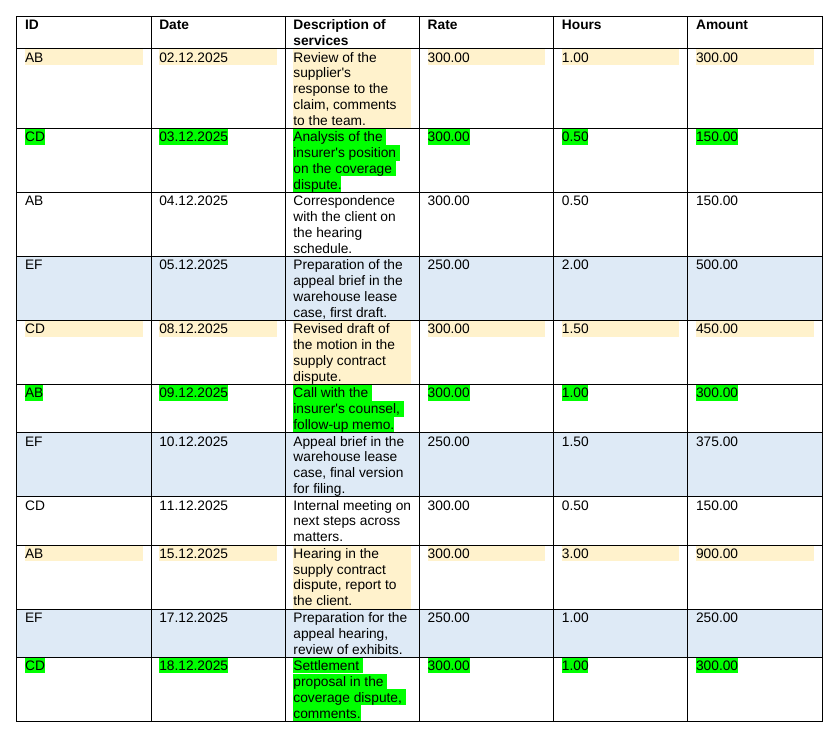
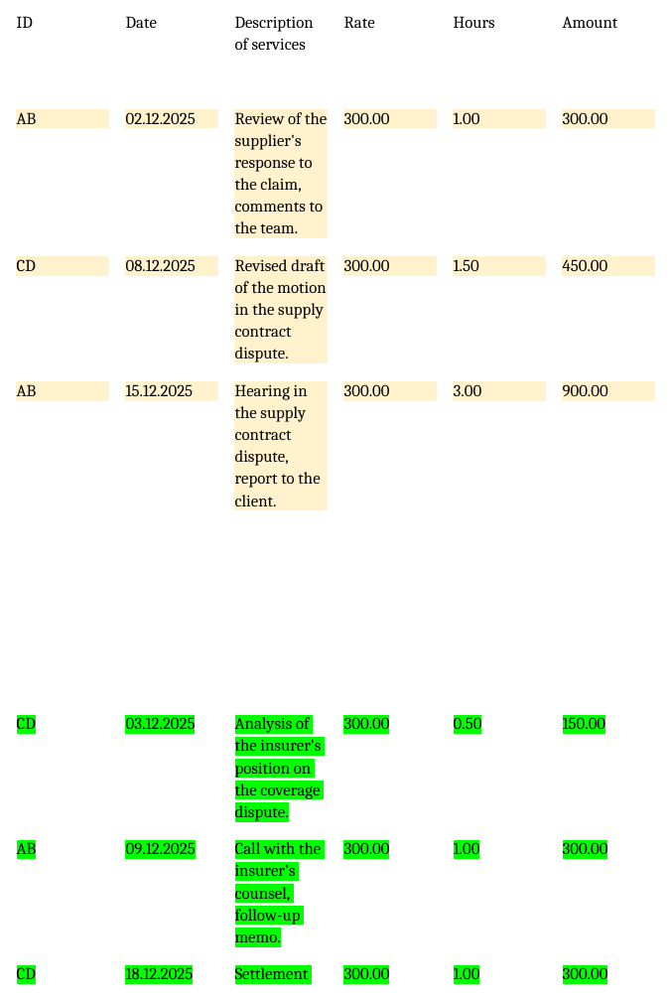

# 1. Rows of a Word table grouped by colour

**The task.** Every month the firm reported to its key client on 6 - 12 matters worked on by 5 - 7 lawyers, and the time entries for the report came as one Word table, in which the rows belonging together were marked with the same colour, and for the report they had to be put together, group by group.

**What the script does.** Word keeps a colour in 3 different places: as shading of the cell, as shading of the paragraph inside the cell, or as highlighter on the text itself, and the files I worked with used more than one of them at once. The script reads all 3 for every row, treats rows with the same set of colours as 1 group and writes a new document: the header row, then each group with 1 empty row before it and 4 after it, the rows inside a group in their original order and with their colours kept.

| Before | After |
| --- | --- |
|  |  |

**How to run it.** `pip install python-docx`, then `python group_rows_by_highlight.py`: it reads `sample/billing_sample.docx` and writes `sample/billing_sample_grouped.docx`. The input has to be .docx, so an old .doc file is first saved as .docx in Word.

## The rounds with ChatGPT

| Round | What I gave or saw | What was wrong | What changed |
| --- | --- | --- | --- |
| 1 | The layout of the table with a few sample rows, and the task in 1 sentence | | The AI explained that Word stores no "colour of a row" and sketched a script grouping by cell shading and highlighter |
| 2 | Asked for a script for my file, saving the result next to it under a new name | | A first full script |
| 3 | The run stopped: no module named docx, and my file was .doc | python-docx was not installed and cannot read .doc at all | Installed python-docx, saved the file as .docx |
| 4 | Asked for the whole script again for the .docx | | |
| 5 | The run went through, but only the uncoloured rows came together, the coloured ones were still mixed | The colour sat in a 3rd place, paragraph shading, which the script did not read | The key rewritten to paragraph shading |
| 6 | Pointed out that some rows were shaded and others highlighted, so all ways had to count | The new key ignored the highlighter | 1 key from all 3 places, and the grouping worked |
| 7 | Asked for 1 empty row before each group and 4 after it | | Done |
| 8 | SyntaxError in line 1 | I had copied the code together with its markdown fence | Fence removed |
| 9 | FileNotFoundError on saving | The AI had doubled a folder in the output path | Path fixed; this is the version I kept using for the report |

## Prepared for publication

The logic is unchanged. The paths point to the sample folder next to the script, the code runs from `main()`, the comments are in English, and the sample is fictional: the real table and its entries were confidential. In the new document the table keeps Word's default look, without borders and with equal columns, so the layout is finished by hand.
