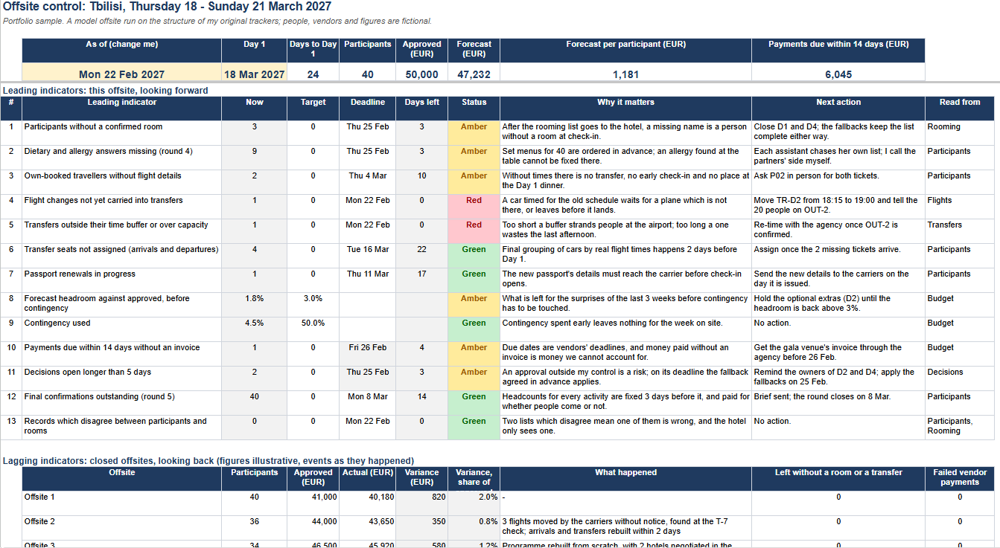
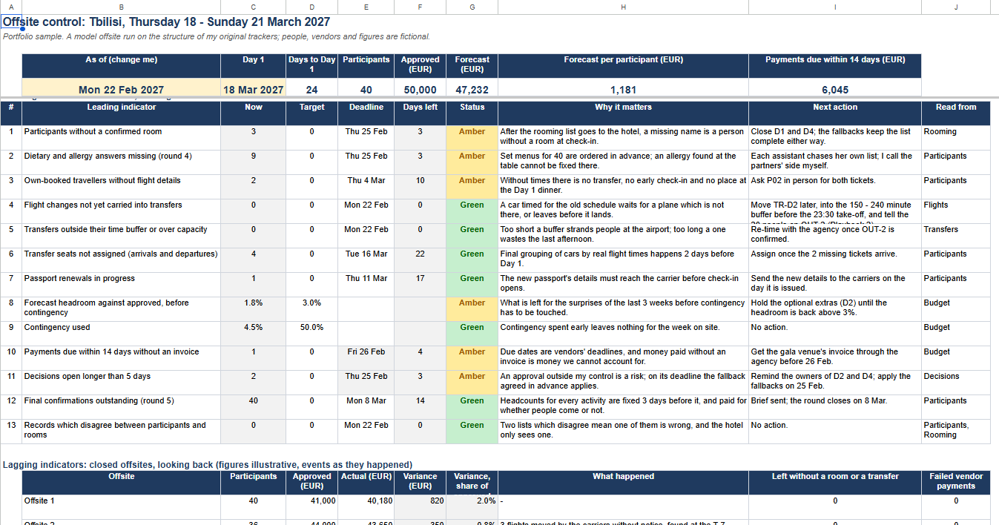

# 3. A playbook which a person or an AI agent can follow

**Where it comes from.** At one of the firm's offsites a routine recheck, a week before departure, found that the carriers had moved 3 flights and told nobody: a car timed for the old schedule waits for a plane which is not there. It was resolved in 2 working days and nobody was lost, and afterwards I wrote it down as Playbook 2 of the offsite plan. In the model offsite of my portfolio it happens again: on 19 February the carrier moves OUT-2 from 22:40 to 23:30, and the departure transfer for 20 people stays where it was.

**What is new here.** The guidebook I wrote for my successor was meant for a person. [PLAYBOOK_2.md](PLAYBOOK_2.md) is written so that an AI agent connected to the workbook can follow it as well: the same steps, plus what the agent may and may not touch, and the points where it stops and waits for the coordinator. The agent finds the change, works out the new transfer within the buffer rules, lists the knock-on effects and drafts the messages; the decisions, and everything which leaves the team, stay with the coordinator.

**Why it is written this way.** A flight change is found when everybody is busiest, and that is exactly when attention is lowest: a coordinator, or a partner who approves things between 2 meetings and answers most emails with "yes", reads the first line and misses the one which mattered. So the agent asks 1 thing at a time, with the facts on 2 - 3 lines, and spells out what a "yes" approves and what a "no" means, so that a one-word answer is still a precise one. The whole run takes 3 - 4 replies, most of them a single word.

## Run it yourself in 5 minutes

1. **Make your own copy of the workbook.** Open the [offsite control workbook](https://docs.google.com/spreadsheets/d/1VDJnpJWNu_MXEThhQAgW-Vc-XflvHn3kSKLHj5RXNk0/edit?usp=sharing), then File → Make a copy. Keep the link to your copy.
2. **Open an AI assistant which can work in Google Sheets**, for example Claude with the Google Sheets connector switched on, signed in with the Google account which owns the copy.
3. **Give it the task.** Open [PROMPT.md](PROMPT.md), click "Copy raw file" (the icon at the top right of the file), paste it into a new chat, replace `PASTE THE LINK TO YOUR COPY HERE` with the link from step 1, and send.
4. **Answer its questions.** With the workbook as it is, expect 3, and "yes" is a full answer to each:

| The agent asks | "Yes" means |
| --- | --- |
| Is OUT-2 now at 23:30? | The carrier's notice says 23:30 |
| Move the transfer TR-D2 from 19:00 to 20:15? | Write 20:15 into the workbook and mark the change as carried through |
| Approve the 5 drafts (3 assistants, the agency, the hotel)? | All 5 as shown, ready for you to send |

5. **Check the result** against the table and the screenshots below. Nothing has been sent to anybody: the drafts are in the chat, for you to send.

## What a correct run ends with

| | Before | After |
| --- | --- | --- |
| TR-D2, pick-up at the hotel | 19:00, buffer 270 minutes | 20:15, buffer 195 minutes (limits 150 - 240) |
| Flights, OUT-2, "Transfer updated" | No | Yes |
| Control, flight changes not carried into transfers | 1, red | 0, green |
| Control, transfers outside their buffer | 1, red | 0, green |
| Knock-on effects listed | | Luggage room until 20:00 for the rooms checking out on Sunday; late check-out until 18:00 still open as decision D3; museum programme unchanged |
| Drafts | | 3 to the assistants (3, 11 and 6 names), 1 to the agency, 1 to the hotel |

| Control before the run | Control after the run |
| --- | --- |
|  |  |

## Run log

2 runs on 30 October 2026, each on a fresh copy of the workbook, with Claude connected to Google Sheets and me as the coordinator.

**Run 1** did what the playbook asked and found more than it was asked to:
- it took the new flight time from the coordinator, not from the workbook;
- it proposed 20:15 by the playbook's own rule and noticed that the expected result written here had said 20:00;
- it found 2 gaps nobody had planned for: 1 room on the late flight with no luggage arrangement, and no meeting point for the departure anywhere in the workbook.

It also showed where the procedure itself was weak: its checkpoints asked several questions in 1 message, and a general "I confirm", which is how approvals get given under pressure, was enough to pass them all, including drafts with a gap still in them.

**What changed after run 1.** 1 question per message; each question states what "yes" approves and what happens on "no"; a draft with a gap is never shown for approval; the meeting point and the luggage arrangement went into the workbook.

**Run 2** went through in 3 single-line replies: 23:30 confirmed, 20:15 approved, drafts 1 - 5 approved. Both red indicators turned green, nothing was written before it was approved, and the report listed 4 things outside the agent's permissions for the coordinator to fix, among them an own-booked return flight whose times coincided exactly with the new OUT-2 times, which was worth a second look. The 2 which concern the workbook itself, the luggage note and that flight, are now corrected in the original.
