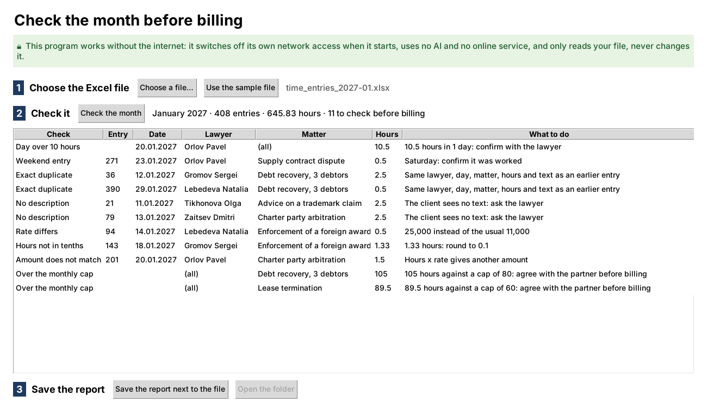

# 4. Confidential data, checked entirely on 1 computer

**The task.** A monthly report on lawyers' hours has to be checked before it goes to the client, for what the client must not see: a day of 14 hours, a duplicate, an entry with no text, a rate typed by mistake, a matter over its monthly cap. The file is confidential, and for some partners even the theory of a leak is too much: they would rather give the job to 3 assistants than let the file near an AI or a website.

**What is shown here.** A small program which does the check with nothing outside the computer involved: no internet, no AI, no online service, and nothing to install besides Python itself. It does less than an AI could, and that is the point: the most confidential way of doing the job, which still saves the hours.

## Run it yourself in 5 minutes

You need Python on the computer: a free download from [python.org](https://www.python.org/downloads/). On Windows, tick "Add Python to PATH" during the installation. Nothing else is installed, now or later.

1. **Download this folder.** On the main page of the repository: the green "Code" button → "Download ZIP", then unpack it and open the folder `04-offline-analysis`.
2. **Start the program.** Windows: double-click `check_month.pyw`. Mac: right-click `start-mac.command` → Open.
3. **Follow the 3 numbered steps in the window:**
   1. "Use the sample file" (or "Choose a file…" for your own);
   2. "Check the month": with the sample, 11 lines to check appear, each with what to do about it;
   3. "Save the report next to the file": a new Excel file appears beside the original, with 4 sheets: Summary, To check, By matter, By lawyer.

## How to be sure nothing leaves the computer

You do not have to take it on trust; each of these takes a minute:

| Check | What you will see |
| --- | --- |
| Switch off Wi-Fi, or unplug the cable, and run the program | It works exactly the same |
| Open `check_month.pyw` in Notepad and read the first lines | The program switches off its own access to the network before it does anything else: any attempt to connect fails |
| Look at the list of what the program uses, a few lines further down | Only modules which come with Python: files, zip, XML, dates, the window. Nothing for the internet, no AI library, nothing downloaded |
| Look at the date your file was last changed, before and after | The same: the file is only read; the report is a separate new file |

## What it checks

| Check | Why it matters before billing |
| --- | --- |
| A lawyer's day over 10 hours | Either a typo or a question the client will ask |
| An entry on a weekend | Worth a word with the lawyer before the client sees it |
| An exact duplicate | The same work billed twice |
| An empty description | The client sees an amount with no explanation |
| A rate which differs from the lawyer's usual one | Usually a typo, sometimes a forgotten agreement |
| Hours not in tenths | The report rounds to 0.1, and 1.33 hours looks careless |
| An amount which is not hours x rate | A number typed over by hand |
| A matter over its monthly cap | Needs the partner's word before the invoice goes out |

The column names and the limits (10 hours a day) are settings at the top of the program, so a file with other column names needs only those lines changed.

## What is in the folder

| File | What it is |
| --- | --- |
| `check_month.pyw` | The whole program, in 1 file you can read |
| `start-mac.command` | Starts it on a Mac |
| `sample/time_entries_2027-01.xlsx` | A fictional month: 408 time entries of an invented law firm, with the problems planted on purpose |
| `make_sample.py` | How the sample was made; the only file here which needs an extra package |

**Who wrote what.** The checks are the ones a monthly report to a client has to pass. The code was written with AI, Claude, in October 2026, on the fictional sample only; once written, it needs no AI and no connection at all, which is the difference from the other cases in this repository.
