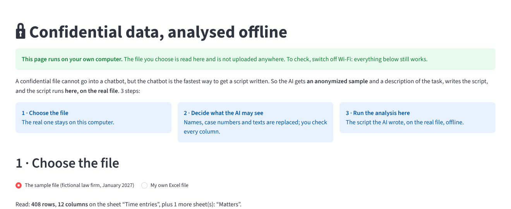
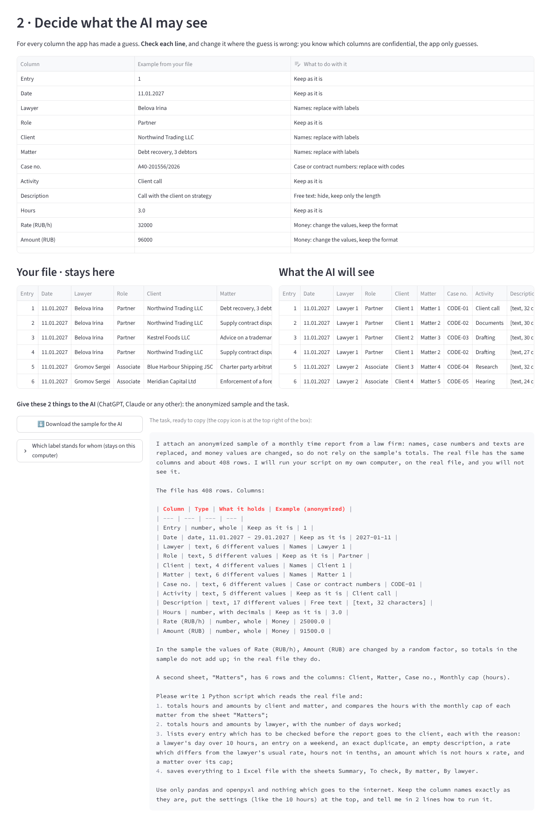
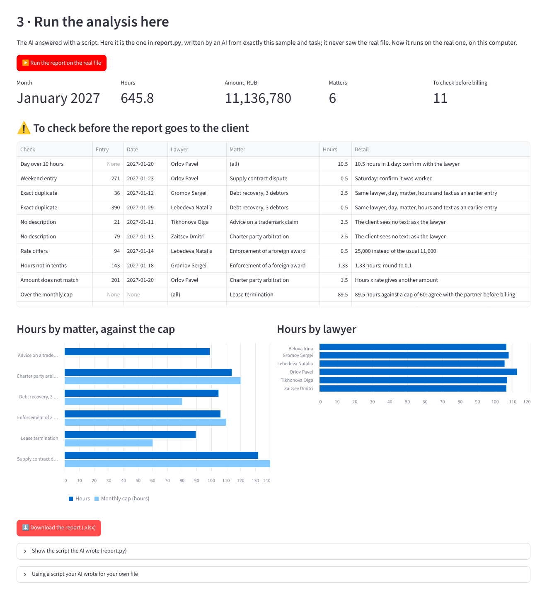

# 4. Confidential data, analysed offline

**The task.** A monthly report on lawyers' hours has to be checked before it goes to the client, for what the client must not see: a day of 14 hours, a duplicate, an entry with no text, a rate typed by mistake, a matter over its monthly cap. The data is confidential, so it cannot go into a chatbot; in January 2026, for the firm's real monthly report, the way round was a script written by the AI from a sample (case 1).

**What is new here.** The same method, made into a small app anyone can run: the confidential file stays on the computer, the AI gets only an anonymized sample and the task in words, writes the script, and the script runs on the real file, here, offline. Everything in the app is in plain language, because the person who most needs it is the one with no time to learn a tool.

## Run it yourself in 5 minutes

You need Python on the computer (from [python.org](https://www.python.org/downloads/); on Windows tick "Add Python to PATH" during the installation).

1. **Download this folder.** On the main page of the repository: the green "Code" button → "Download ZIP", then unpack it and open the folder `04-offline-analysis`.
2. **Start the app.** Windows: double-click `start-windows.bat`. Mac: right-click `start-mac.command` → Open. The first start installs 3 packages from the internet, once; after that the app works with Wi-Fi switched off.
3. **The app opens in your browser.** It looks like a website, but it runs on your computer: the address is `localhost`, and the file you choose is read there and sent nowhere.
4. **Follow the 3 steps on the page.** With the sample file, step 3 finds 11 entries to check, planted in the sample on purpose.

To stop it, close the black window which opened in step 2.

## The 3 steps

**1 · Choose the file.** The fictional sample (408 time entries of a law firm for January 2027) or any Excel file of your own.

**2 · Decide what the AI may see.** For every column the app guesses what it holds and what to do with it; the person checks every line and changes what is wrong, since only the person knows what is confidential.

| Kind of column | What the AI gets instead |
| --- | --- |
| Names of people, clients, matters | Labels: Lawyer 1, Client 2, Matter 3. The same name always gets the same label, so the AI still sees who did what |
| Case and contract numbers | CODE-01, CODE-02 ... |
| Free text | "[text, 32 characters]": the AI knows a text is there, not what it says |
| Money | The values changed by a random factor, in the same format and of the same size |
| Dates, hours, roles, types of work | Kept: they say nothing about the client |

On the left the real file, on the right what the AI will see, row by row. Then 2 things to give the AI: the anonymized sample, as a file to download, and the task, ready to copy. The list of which label stands for whom stays on the computer.

**3 · Run the analysis here.** The script which the AI wrote from the sample and the task runs on the real file: totals by matter against the caps and by lawyer, and a list of what to check before billing, each line with its reason. The report downloads as 1 Excel file.

## What is in the folder

| File | What it is |
| --- | --- |
| `start-windows.bat`, `start-mac.command` | Double-click to start |
| `app.py` | The page you see |
| `anonymize.py` | Step 2: the guess for every column, the anonymized sample and the description of the file |
| `PROMPT.md` | The task as it went to the AI, word for word |
| `report.py` | Step 3: the script the AI wrote, with the date and what it was checked against |
| `make_sample.py`, `sample/` | The fictional file, and how it was made, with the problems planted in it |
| `.streamlit/config.toml` | The app's settings: no usage statistics, and it listens only on this computer |

**Who wrote what.** The method is the one from case 1 and from rule 1 of [how I work with AI](https://app.notion.com/p/40953e51f1d581a7b90cc0a51e923f30). The app, the anonymization and `report.py` were written by AI, Claude, in October 2026, to my brief, and `report.py` from the anonymized sample and the task alone; its result was checked against the problems planted in the sample, all of which it finds.

**Where the method stops.** Anonymization lowers the risk, it does not remove it: a rare amount or an unusual phrase can identify a client even without a name. So rule 0 of the same page comes first: the company's policy on AI decides what may go to an AI at all, and this app is for the cases where a sample may.
