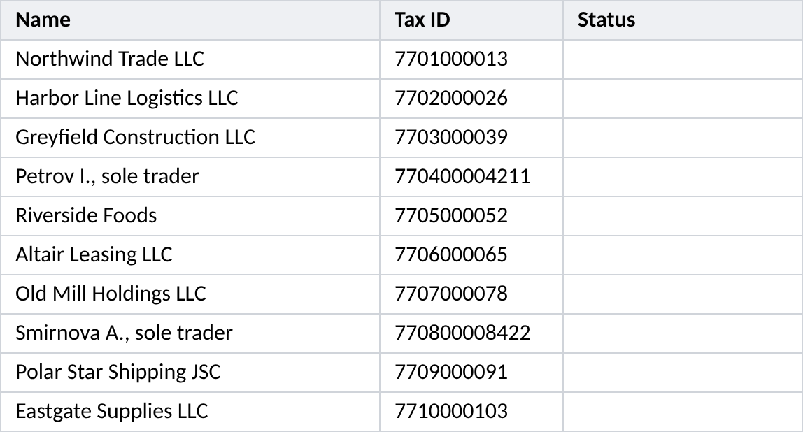
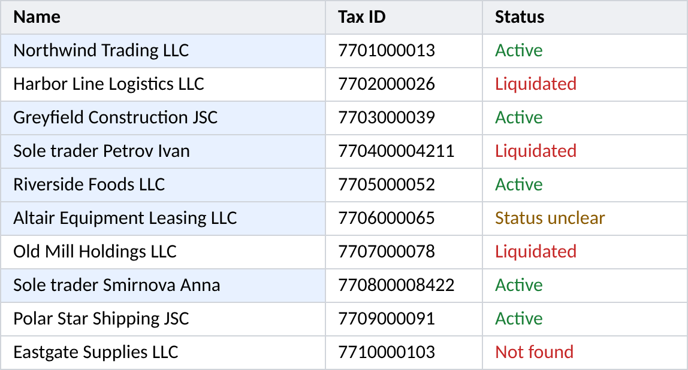
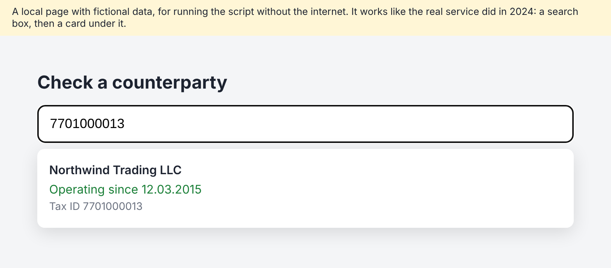

# 5. Counterparties checked by tax ID in a public service (December 2024)

**The task.** For one of the firm's matters there was a table of several hundred counterparties from whom a debt could not be recovered, companies and sole traders, collected over several years. Before the next step it had to be known which of them still existed: who was still operating, who had been liquidated, and under what name each was now registered, since many had changed it. A public company-check service answered this for 1 tax ID at a time: type it into the search box and a card appears with the current name and the status. By hand that is several hundred searches.

**What the script does.** For every tax ID in column B it opens the service in a browser, types the ID, waits for the card and reads 2 lines from it: the name into column A, the status into column C. The status is written only when the page states it: "Active" when the card says the company is operating, "Liquidated" when it says liquidated and not operating, "Not found" only when the page says there is no such counterparty, and "Status unclear" for anything else, such as a reorganisation. When the card has not loaded, the row gets "Could not read status" and keeps its name, and a second pass goes over those rows again at the end.

This is one of the first scripts I had AI write for the firm's own tasks, in December 2024, 4 months after I started doing it in August 2024 and 2 months before the practice got its name, "vibe coding", in February 2025.

| The table before | After the script |
| --- | --- |
|  |  |

*In the picture on the right, shading marks the names the script updated. The script itself changes only the text.*

## Run it yourself

1. `pip install selenium openpyxl`, and Firefox on the computer (or Chrome, with `BROWSER = "chrome"` at the top of the script).
2. `python check_counterparties.py`. A browser window opens and goes through the 10 fictional counterparties in `sample/counterparties.xlsx` on a local copy of a service page, `sample/mock_service/index.html`, so nothing goes to the internet. It takes about 1.5 minutes.
3. The result is `sample/counterparties_checked.xlsx`: 5 active, 3 liquidated, 1 unclear, 1 not found. 2 of the counterparties load slowly on the first search, longer than the script waits, so the first pass marks them "Could not read status" and the second pass reads them.

`python make_sample.py` makes the sample table again.

## How it was built

8 rounds in a ChatGPT chat. In December 2024 the AI could not see the site, the table or my computer: I described the task, ran every version, and brought back the error or what the table looked like after the run.

| Round | What the run showed | What fixed it |
| --- | --- | --- |
| 1 | The first version was written for Chrome, and ChromeDriver was not available to me | The same script for Firefox and its driver |
| 2 | "SyntaxError: (unicode error)" on the line with the driver path | Windows backslashes in a Python string: the path written as a raw string |
| 3 | "The path is not a valid file", "Unable to obtain driver for firefox" | The path and the driver file checked again; after that the browser started |
| 4 | "NoSuchElementError": the script could not find the search box | The AI had guessed the search box by its name. I copied the HTML of the actual search box from the page, and the script found it by its own attribute |
| 5 | The script searched for the names instead of the tax IDs | The table described again: tax ID in column B, name in column A |
| 6 | Looking for phrases anywhere on the page was unreliable | I copied the HTML of the result card, and the script reads only the card. At the same time, instead of filling cells red, the status is written in column C. In this version, though, every counterparty which was neither liquidated nor missing was marked active by default |
| 7 | A status the page had not stated was a guess | The rule I set: "Active" only when the card says operating, "Liquidated" only when it says liquidated and not operating, otherwise "Status unclear". The name is taken from the first line of the card. But when the card failed, this version wrote "could not read the name" over the real name |
| 8 | Many rows came back "could not read status", most likely because the page had not finished loading; and names were lost | The name stays as it was when nothing was read; "Not found" only when the page says so; a 5-second wait before reading; a second pass over the rows where nothing was found. This is the version I ran on the table |

## Prepared for publication

The service and the matter are not named. The URL and the selectors of the real service are settings at the top of the script, pointed here at the local page, which is built the same way: a search box, and a card under it with the name on line 1 and the status on line 2. The real service was in Russian, so the phrases it looked for are now English settings, and so are the statuses. The table and the counterparties are fictional; the real table was confidential.

Also: the paths are settings and the driver path is optional, since Selenium now finds the driver itself; `HEADLESS` replaces a line which did nothing in the Selenium of 2024; errors are caught by type rather than all at once; and for the sample the result goes into a new file, while in 2024 the script wrote into the table itself (`OUTPUT = None` does that).

3 problems are fixed here and marked `FIX` in the code. All 3 showed up when the script was run on the fictional sample for this page:

1. The second pass went over the wrong rows. It was asked to recheck the rows where nothing could be read, but the condition picked the rows marked "Not found", which are the only ones the page had answered for certain, and skipped the rest. On the sample, with the 2024 rule, the 2 slow rows stay "Could not read status"; with the fix they are read.
2. On the second pass the name was not written, so a counterparty read on the second pass got its status but kept its old name.
3. If the browser failed to start, the step that saves the table and closes the browser crashed itself and hid the real error.
